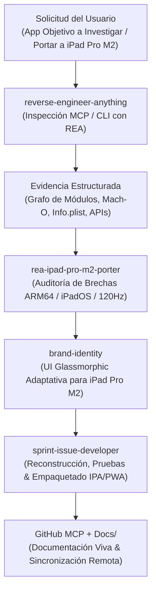

# 🧠 Índice Maestro de Habilidades Autónomas (`.agents/SKILLS.md`) — Proyecto REA en Antigravity

> **Desarrollador Líder:** Rogerr Carvajal ([@rogerrcarvajal](https://github.com/rogerrcarvajal))  
> **Especialidad:** Arquitectura de Software con Modelos y Agentes Inteligentes  
> **Proyecto:** REA (Reverse Engineer Anything) — Ecosistema de Ingeniería Inversa y Portabilidad iPad Pro M2  
> **Estándar:** Google Antigravity Customization System (`.agents/` & `~/.gemini/config/`)

---

## 📌 1. Propósito del Índice

Este archivo centraliza la gobernanza y descubrimiento progresivo (*progressive disclosure*) de todas las **Habilidades Autónomas (Agent Skills)** activas en el proyecto **REA (Reverse Engineer Anything)** dentro de **Google Antigravity**, unificando:
1. **Las 5 habilidades nativas del motor REA (`morluto/rea`)** para ingeniería inversa de binarios, aplicaciones JavaScript/Electron, paquetes Apple/Android, firmware y tráfico web.
2. **Las 4 habilidades globales de ingeniería de Antigravity (`@rogerrcarvajal`)** para identidad de marca, creación de skills, desarrollo de sprints en bucle y generación de changelogs.
3. **La habilidad especializada de portabilidad `rea-ipad-pro-m2-porter`** para analizar aplicaciones incompatibles y reconstruirlas/adecuarlas para instalación y ejecución fluida en **iPad Pro M2 (iPadOS / Apple Silicon ARM64)**.

---

## 🗂️ 2. Catálogo Unificado de Habilidades en `.agents/skills/`

### A. Núcleo de Ingeniería Inversa REA (Originarias de `morluto/rea`)

| Habilidad (Skill) | Ruta en Workspace | Propósito y Triggers de Activación |
| :--- | :--- | :--- |
| **`reverse-engineer-anything`** | [`.agents/skills/reverse-engineer-anything/SKILL.md`](skills/reverse-engineer-anything/SKILL.md) | **Skill Principal de REA**: Guía el análisis estático y dinámico de binarios nativos (Mach-O, PE, ELF), apps Electron/ASAR/JS, ensamblados .NET, paquetes `.ipa`/`.apk`/`.dmg`, bases SQLite, WebAssembly y capturas de navegador/red. |
| **`rea-ipad-pro-m2-porter`** | [`.agents/skills/rea-ipad-pro-m2-porter/SKILL.md`](skills/rea-ipad-pro-m2-porter/SKILL.md) | **Portabilidad a iPad Pro M2**: Pipeline de 5 fases que utiliza la evidencia extraída por REA para auditar brechas de compatibilidad (ARM64, Stage Manager, ProMotion 120Hz, Apple Pencil 2 Hover) y transformar aplicaciones en paquetes `.ipa` o PWAs instalables en iPadOS. |
| **`rea-tool-design`** | [`.agents/skills/rea-tool-design/SKILL.md`](skills/rea-tool-design/SKILL.md) | Diseño y extensión de contratos de herramientas MCP/CLI dentro de REA conservando procedencia de evidencia (`Evidence`), límites de memoria y esquemas JSON. |
| **`rea-analysis-optimization`** | [`.agents/skills/rea-analysis-optimization/SKILL.md`](skills/rea-analysis-optimization/SKILL.md) | Optimización de consumo de tokens de agente, tiempo de análisis y memoria en flujos de investigación con REA. |
| **`rea-ci-tests-audit`** | [`.agents/skills/rea-ci-tests-audit/SKILL.md`](skills/rea-ci-tests-audit/SKILL.md) | Auditoría de pruebas de frontera (`boundary`, `mcp-boundary`, `acceptance`) y verificación de proveedores reales. |
| **`rea-changelog-update`** | [`.agents/skills/rea-changelog-update/SKILL.md`](skills/rea-changelog-update/SKILL.md) | Mantenimiento de notas de versión y sincronización con `CHANGELOG.md` del motor REA. |

### B. Ecosistema Global Antigravity (Estándar Rogerr Carvajal)

| Habilidad (Skill) | Ruta en Workspace | Propósito y Triggers de Activación |
| :--- | :--- | :--- |
| **`brand-identity`** | [`.agents/skills/brand-identity/SKILL.md`](skills/brand-identity/SKILL.md) | Aplica la marca personal de **Rogerr Carvajal**, diseño **Glassmorphic Dark Mode** (ideal para interfaces en pantallas Liquid Retina XDR del iPad Pro M2) y estándares de arquitectura limpia. |
| **`sprint-issue-developer`** | [`.agents/skills/sprint-issue-developer/SKILL.md`](skills/sprint-issue-developer/SKILL.md) | Desarrollo iterativo en bucle sin errores (*looping*), verificación de aceptación y creación de Pull Requests con trazabilidad `Ref #X` vía GitHub MCP. |
| **`skill-creator`** | [`.agents/skills/skill-creator/SKILL.md`](skills/skill-creator/SKILL.md) | Metodología oficial Plan → Validar → Ejecutar → Revisar para diseñar, validar y evaluar nuevas habilidades en Antigravity. |
| **`changelog-generator`** | [`.agents/skills/changelog-generator/SKILL.md`](skills/changelog-generator/SKILL.md) | Generación automatizada de notas de lanzamiento categorizadas a partir de commits de Git para GitHub Releases. |

---

## 🔄 3. Orquestación de Flujo de Trabajo en Antigravity

---

## 🔌 4. Servidores MCP Vinculados (`.agents/mcp_config.json`)

1. **`rea` (`io.github.morluto/rea`)**: Servidor MCP oficial de ingeniería inversa local (`npx -y rea-agents@latest mcp`).
2. **`github` (`@modelcontextprotocol/server-github`)**: Servidor MCP para sincronización continua del repositorio, gestión de ramas, issues y Pull Requests.
