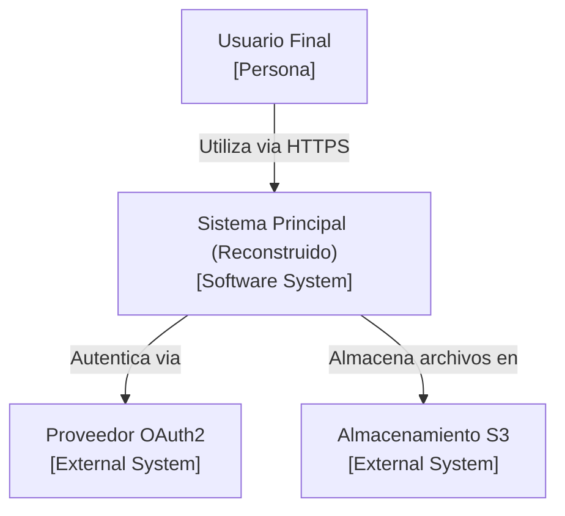
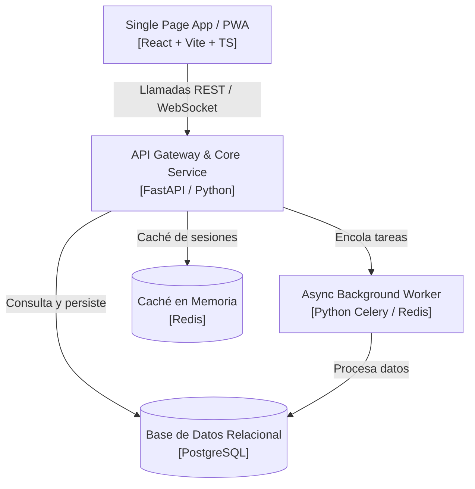
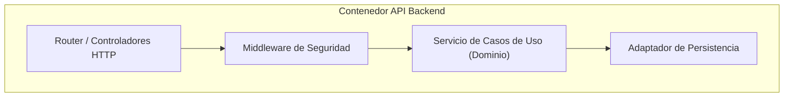

# C4 Model: Arquitectura y Diagramación

Esta habilidad estructura y genera documentación de arquitectura siguiendo la metodología C4 (Context, Containers, Components, Code) mediante diagramas Mermaid renderizables.

## Cuándo usar esta habilidad

- Documentar la arquitectura de un sistema deconstruido de alto a bajo nivel.
- Planificar la nueva arquitectura desacoplada antes de escribir código de implementación.
- Comunicar decisiones técnicas a stakeholders de negocio (Contexto/Contenedores) y a desarrolladores (Componentes/Código).

## Los 4 Niveles de la Arquitectura C4

### Nivel 1: Diagrama de Contexto de Sistema (System Context)
Muestra el sistema en el centro, los usuarios/actores que interactúan con él y los sistemas externos de soporte.

### Nivel 2: Diagrama de Contenedores (Containers)
Desglosa el sistema en aplicaciones ejecutables, APIs, workers y almacenes de datos.

### Nivel 3: Diagrama de Componentes (Components)
Dentro de un contenedor clave (e.g., el backend), muestra los módulos lógicos: controladores, servicios de caso de uso, adaptadores y repositorios.

### Nivel 4: Diagrama de Código (Code)
Detalla la estructura interna de componentes complejos: interfaces, clases y modelos de dominio.
