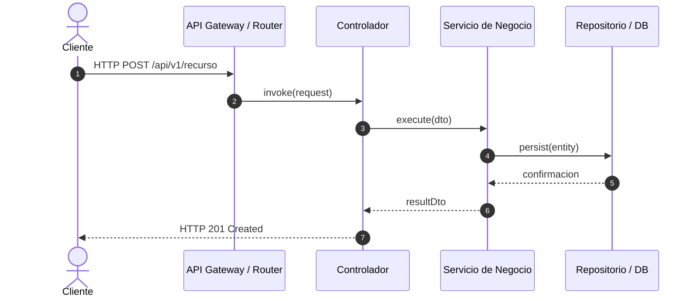

# Codebase Analysis & Arqueología de Código

Esta habilidad guía el proceso sistemático de deconstrucción y análisis de un sistema base existente o legado, mapeando sus puntos de entrada, rutas de ejecución, dependencias ocultas y árboles de llamadas para preparar una reconstrucción limpia (Clean-Room Design).

## Cuándo usar esta habilidad

- Mapear la arquitectura real de un sistema heredado o aplicación existente.
- Descubrir rutas HTTP, endpoints, controladores y middlewares activos.
- Rastrear el flujo de ejecución (call trees) desde los puntos de entrada hasta la persistencia.
- Identificar dependencias ocultas, acoplamientos indeseados o dependencias circulares.
- Extraer la lógica de negocio subyacente antes de iniciar un rediseño desacoplado.

## Flujo de Trabajo Operativo

### Fase 1: Inventario y Superficie de Ataque / Puntos de Entrada
1. **Identificar Puntos de Entrada (Entrypoints):**
   - Rutas HTTP / REST (e.g., `routes/`, `controllers/`, `@app.get`, `urls.py`).
   - Comandos CLI y scripts ejecutables (`cli.ts`, `manage.py`, `console`).
   - Workers, tareas en segundo plano (Cron, Celery, Queues).
   - Event Listeners, Webhooks y WebSockets.
2. **Generar Tabla de Rutas:**
   Documentar cada ruta, método HTTP, middleware asociado y controlador destino.

### Fase 2: Árboles de Llamadas (Call Trees) y Trazabilidad
1. Para cada caso de uso crítico, seguir la llamada:
   `Controlador -> Servicio de Aplicación -> Lógica de Dominio -> Repositorio / DB`.
2. Identificar bifurcaciones, validaciones implícitas y efectos secundarios (envío de emails, llamadas a APIs externas, mutaciones de estado global).
3. Representar el flujo mediante diagramas de secuencia Mermaid:

### Fase 3: Grafo de Dependencias y Acoplamiento
1. Mapear dependencias internas entre módulos (Imports / Requires).
2. Detectar dependencias circulares y violaciones de capas (e.g., UI llamando directamente a la base de datos).
3. Inventario de dependencias externas (paquetes npm, pip, gemas, APIs de terceros).

### Fase 4: Entregable de Deconstrucción
Generar el reporte `Codebase-Deconstruction-Report.md` que incluye:
- **Resumen Ejecutivo:** Propósito del sistema y tecnologías base identificadas.
- **Catálogo de Endpoints y Entradas:** Métodos, URLs y controladores.
- **Flujos de Ejecución Clave:** Diagramas de secuencia y llamadas.
- **Mapa de Dependencias:** Grafo de módulos y librerías externas críticas.
- **Deuda Técnica y Puntos de Dolor:** Anti-patrones, acoplamiento rígido, lógica duplicada.
