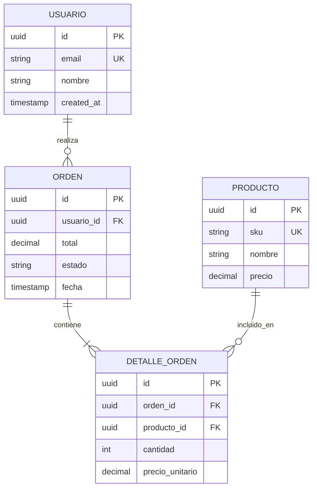

# Database Schema Extraction & Modelado DER

Esta habilidad analiza fuentes de datos existentes (archivos `.sql`, migraciones de base de datos, definiciones de modelos ORM como Prisma, TypeORM, Sequelize, SQLAlchemy, Eloquent) para reconstruir el modelo Entidad-Relación (DER), las restricciones de integridad y el diccionario de datos formal.

## Cuándo usar esta habilidad

- Deconstruir la estructura de base de datos de un proyecto legado o externo.
- Generar diagramas Entidad-Relación interactivos en Mermaid (`erDiagram`).
- Descubrir relaciones implícitas (campos `*_id` sin restricciones `FOREIGN KEY` explícitas).
- Rediseñar el esquema para una arquitectura limpia, normalizada y optimizada.

## Proceso de Reconstrucción

### 1. Extracción de Entidades y Atributos
- Analizar sentencias `CREATE TABLE`, interfaces ORM o migraciones históricas.
- Registrar para cada columna: nombre, tipo de dato nativo, nulabilidad, valor por defecto, si es clave primaria (`PK`) o foránea (`FK`).

### 2. Detección de Relaciones e Integridad Referencial
- **Relaciones Explícitas:** Cláusulas `FOREIGN KEY ... REFERENCES`.
- **Relaciones Implícitas:** Detectar convenciones de nomenclatura (e.g., `user_id`, `company_code`) donde la base de datos no tiene llaves foráneas definidas a nivel de motor.
- **Cardinalidades:** Clasificar en 1:1, 1:N y N:M (tablas intermedias de unión).

### 3. Generación de Diagramas Mermaid ER

### 4. Diccionario de Datos Estandarizado
Generar para cada entidad una tabla markdown con:
- Campo, Tipo, Clave (PK/FK/UK), Nulo (Sí/No), Descripción de negocio, Reglas de validación.
