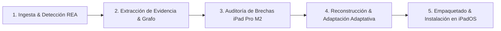

# REA iPad Pro M2 Application Porter & Reverse Engineering Workflow

> **Desarrollador Líder:** Rogerr Carvajal ([@rogerrcarvajal](https://github.com/rogerrcarvajal))  
> **Especialidad:** Arquitectura de Software con Modelos y Agentes Inteligentes  
> **Ecosistema:** REA (Reverse Engineer Anything) + Google Antigravity + iPad Pro M2 (Apple Silicon M2 / iPadOS)

---

## 📌 1. Propósito de la Habilidad

Esta habilidad extiende el flujo original de **REA (`reverse-engineer-anything`)** en **Google Antigravity** con un pipeline de ingeniería inversa y portabilidad diseñado específicamente para **analizar aplicaciones que aún no están diseñadas ni adecuadas para el iPad Pro M2** (apps de escritorio Electron/JS, ejecutables Windows/macOS, APKs de Android, apps iOS legacy solo-iPhone o sitios web complejos) y **reconstruirlas, adecuarlas e instalarlas** para ejecutarse sin problemas en el **iPad Pro M2**.

---

## 🧭 2. Flujo de Trabajo en 5 Fases (REA → Arquitectura → Adecuación iPad Pro M2 → Empaquetado → Instalación)



### Fase 1: Identificación y Enrutamiento del Artefacto en REA
Según el formato de la aplicación objetivo que aún no es compatible con iPad Pro M2, selecciona la herramienta REA correspondiente:

| Tipo de Aplicación Origen | Herramienta REA Primaria | Objetivo de Extracción |
| :--- | :--- | :--- |
| **App de Escritorio Electron / ASAR / JS** | `analyze_javascript_application` (`detail: "summary"`) + `inspect_analysis_view` | Extraer grafo de módulos, canales IPC (`ipcMain`/`ipcRenderer`), dependencias de Node.js y addons nativos `.node`. |
| **Paquete Apple (`.ipa` iPhone-only, `.app` macOS, `.dmg`)** | `open_binary` → `inspect_artifact` → `project_apple_application_graph` → `inspect_plist` | Detectar `UIDeviceFamily`, arquitecturas Mach-O (`inspect_macho`), resolución de `@rpath` (`trace_dylib_resolution`), Storyboards/NIBs (`decode_interface_builder`) y firmas (`inspect_signature`). |
| **Aplicación Android (`.apk`)** | `inspect_android_package` + `inspect_apktool_resources` | Extraer actividades, servicios, layouts, flujos de API y lógica de negocio descompilada con JADX para portarla a iPadOS. |
| **Binario Nativo (Windows PE / Linux ELF / macOS Mach-O)** | `open_binary` → `binary_overview` → `analyze_function` / `procedure_pseudo_code` | Recuperar algoritmos clave, protocolos de red, formatos de archivo o motores de cálculo para reimplementarlos en Swift/TypeScript/WASM. |
| **Aplicación Web / SaaS No-Instalable** | `capture_browser_scenario` / `inspect_web_page` / `inspect_web_network_capture` | Capturar recursos, llamadas API, WebAssembly (`inspect_wasm_artifact`) y estado DOM para transformarla en una PWA instalable o wrapper nativo Capacitor/SwiftUI. |

---

### Fase 2: Auditoría de Compatibilidad y Brechas para iPad Pro M2 (Hardware & SO)

Todo análisis dirigido al **iPad Pro M2** debe evaluar las siguientes dimensiones técnicas en un **Ledger de Obligaciones de Portabilidad**:

1. **Arquitectura de Binarios y Runtime (Apple Silicon M2 - `arm64` / `arm64e`)**:
   - En iPadOS no existe Rosetta 2 (a diferencia de macOS). Cualquier binario `x86_64` o addon nativo de Node/桌面 debe migrarse a **`arm64` nativo (iOS/iPadOS SDK)** o compilarse a **WebAssembly (WASM)**.
   - Uso de `inspect_macho` y `trace_dylib_resolution` para detectar enlaces a frameworks exclusivos de macOS (`AppKit`) que deben migrarse a `UIKit` / `SwiftUI` o **Mac Catalyst**.
2. **Metadatos de `Info.plist` (`inspect_plist`)**:
   - Verificar `UIDeviceFamily`: debe incluir `2` (iPad) además de `1` (iPhone).
   - Verificar `UIRequiresFullScreen`: eliminar o establecer en `false` para soportar **Stage Manager**, **Split View** y **Slide Over** en el iPad Pro M2.
   - Verificar `UISupportedInterfaceOrientations~ipad`: habilitar las 4 orientaciones para uso con Magic Keyboard y modo vertical/horizontal.
3. **Pantalla Liquid Retina / XDR y ProMotion (120Hz)**:
   - Resoluciones objetivo: **11" (2388 × 1668 px @ 264 ppi)** y **12.9" mini-LED XDR (2732 × 2048 px @ 264 ppi)** con factor de escala `@2x`.
   - Soportar `CADisplayLink` / `requestAnimationFrame` a **120fps (ProMotion)** sin bloqueos del hilo principal.
   - Respetar `safe-area-inset-*` para la barra de estado y el indicador Home de iPadOS.
4. **Periféricos del Ecosistema iPad Pro M2**:
   - **Apple Pencil 2 (Hover / Puntero a distancia de 12mm)**: Soportar `UIHoverGestureRecognizer` en nativo o eventos `pointermove` / `:hover` precisos sin disparar `touchstart` prematuro.
   - **Magic Keyboard & Trackpad**: Soportar cursores adaptativos (`UIPointerInteraction`), atajos de teclado (`UIKeyCommand`) y scroll inercial.

---

### Fase 3: Selección de Vía de Adecuación e Instalación en iPad Pro M2

Selecciona una de las **3 vías de ejecución e instalación** según la naturaleza de la aplicación analizada con REA:

#### Vía A: Parcheo y Adecuación Directa de `.ipa` / Bundle Apple (Nativo / SwiftUI / Catalyst)
Ideal cuando el objetivo es un `.ipa` de iPhone que se ve pixelado/recortado en el iPad Pro M2 o un `.app` de macOS:
1. Extraer artefacto con `extract_artifact` e inspeccionar `Info.plist` con `inspect_plist`.
2. Inyectar `UIDeviceFamily = [1, 2]`, `UISupportsDocumentBrowser`, y soporte de `UIApplicationSceneManifest` para múltiples ventanas en Stage Manager.
3. Re-firmar e instalar en el iPad Pro M2 mediante **Xcode (Apple Developer Account)**, **AltStore / SideStore**, **Sideloadly** o **TestFlight**.

#### Vía B: Conversión de App de Escritorio (Electron / Node / Python / PHP) a App Híbrida / Capacitor (.ipa)
Ideal cuando la aplicación original usa Electron, ASAR o tecnologías web de escritorio:
1. Ejecutar `analyze_javascript_application` y `trace_application_feature` para separar la interfaz (`renderer`) de las llamadas al sistema (`ipcMain`, `fs`, `child_process`, `sqlite`).
2. Reemplazar llamadas exclusivas de Electron (`ipcRenderer.invoke`) por un puente **Capacitor 6+ (iOS ARM64)** o almacenamiento local **IndexedDB / SQLite WASM**.
3. Aplicar diseño **Glassmorphic Dark Mode** (`brand-identity`) adaptado a iPad Pro M2 (Sidebar colapsable estilo `UISplitViewController`, barra de herramientas superior, soporte táctil de 44×44pt mínimo y Apple Pencil Hover).
4. Generar el proyecto iOS (`npx cap add ios`) y compilar el `.ipa` para instalación directa.

#### Vía C: Reconstrucción como Progressive Web App (PWA) Instalable en Pantalla de Inicio (Standalone iPadOS 16.4+)
Ideal para despliegue inmediato sin cables ni revocación de certificados cada 7 días:
1. Reconstruir el frontend y la lógica extraída por REA como una aplicación web auto-contenida o servida en red local/cloud.
2. Configurar `manifest.webmanifest` con `"display": "standalone"`, `"orientation": "any"`, e iconos de alta densidad (`152x152`, `167x167`, `180x180`, `512x512`, `1024x1024`).
3. Incluir meta-tags específicos de iPadOS en el `<head>`:
   ```html
   <meta name="apple-mobile-web-app-capable" content="yes">
   <meta name="apple-mobile-web-app-status-bar-style" content="black-translucent">
   <meta name="apple-mobile-web-app-title" content="NombreApp">
   <meta name="viewport" content="width=device-width, initial-scale=1.0, viewport-fit=cover, maximum-scale=5.0">
   <link rel="apple-touch-icon" sizes="167x167" href="/icons/ipad-pro-167.png">
   ```
4. Registrar un `Service Worker` con caché offline (`CacheFirst` / `StaleWhileRevalidate`) y almacenamiento persistente (`navigator.storage.persist()`), permitiendo instalarla desde Safari en el iPad Pro M2 con **"Compartir → Agregar a pantalla de inicio"** y ejecutarse a pantalla completa como app nativa.

---

## ✅ 4. Mini Checklist de Validación (Post-Adecuación)

Antes de dar por completada la adecuación de una aplicación para el iPad Pro M2, verifica:
- [ ] ¿Se documentó toda la evidencia extraída por REA (`evidence_id`, `target_sha256`, limitaciones e incógnitas) en `Docs/`?
- [ ] ¿La aplicación soporta multitarea de iPadOS (**Stage Manager**, **Split View**, redimensionado dinámico sin recorte)?
- [ ] ¿Todos los objetivos táctiles tienen al menos `44px × 44px` y responden tanto a toque como a **Apple Pencil 2 Hover** y **Trackpad**?
- [ ] ¿Se eliminaron dependencias nativas `x86_64` o APIs exclusivas de escritorio (`electron`, `fs` crudo sin puente) para evitar fallos en ejecución sobre el chip M2?
- [ ] ¿Cuenta con paquete instalable (`.ipa` firmado o manifiesto PWA `standalone` + `Service Worker` activo)?
