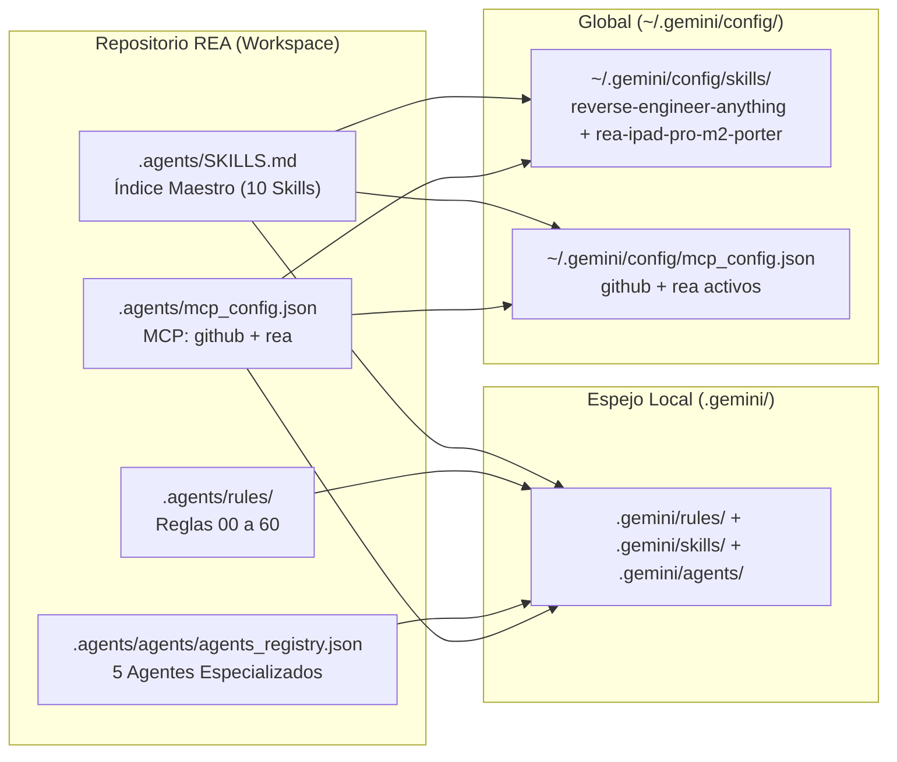

# ⚙️ Adecuación de `.agents/`, `SKILLS.md`, Reglas y Multi-Agentes en Antigravity

> **Desarrollador Líder:** Rogerr Carvajal ([@rogerrcarvajal](https://github.com/rogerrcarvajal))  
> **Ubicación:** `Docs-Antigravity/02-Adecuacion-Antigravity/01-Configuracion-Agents-y-Skills.md`  
> **Archivos Configurados:** [`.agents/SKILLS.md`](../../.agents/SKILLS.md), [`.agents/agents/agents_registry.json`](../../.agents/agents/agents_registry.json), [`.agents/rules/`](../../.agents/rules/)

---

## 1. Estrategia de Integración No-Destructiva (Additive & Idempotent)

El repositorio original de REA (`morluto/rea`) ya utiliza la carpeta `.agents/skills/` para mantener su habilidad empaquetada (`reverse-engineer-anything`) y sus 4 habilidades de mantenimiento interno (`rea-analysis-optimization`, `rea-changelog-update`, `rea-ci-tests-audit`, `rea-tool-design`).

Siguiendo la regla de oro de `AGENTS.md` (*"Configuration changes must be additive and idempotent"*), la adecuación para **Google Antigravity** se ejecutó de manera **aditiva y simétrica** en tres capas:

1. **Workspace Primario (`.agents/`):** Raíz oficial de descubrimiento de Antigravity y de REA.
2. **Espejo Dual del Workspace (`.gemini/`):** Garantiza compatibilidad total con flujos de plantillas Antigravity IDE.
3. **Configuración Global del Usuario (`~/.gemini/config/`):** Permite que las habilidades `reverse-engineer-anything` y `rea-ipad-pro-m2-porter`, así como el servidor MCP de REA, estén disponibles en **cualquier proyecto** abierto en Antigravity.

---

## 2. Jerarquía de Reglas en 3 Niveles (`.agents/rules/`)

Se integraron las 6 reglas de la Configuración Profunda de Antigravity junto con una **7.ª regla especializada** para REA y portabilidad a iPad Pro M2:

| Código | Archivo en `.agents/rules/` | Responsabilidad Principal |
| :--- | :--- | :--- |
| **`00`** | [`00-global-principles.md`](../../.agents/rules/00-global-principles.md) | Español técnico, principios SOLID/DRY/Clean Architecture, seguridad Zero-Trust y Conventional Commits. |
| **`10`** | [`10-workspace-architecture.md`](../../.agents/rules/10-workspace-architecture.md) | Ecosistema políglota (Python FastAPI, PHP 8.2+ PDO, TypeScript/React, Go/Rust) y patrón Hexagonal/DDD. |
| **`20`** | [`20-python-ai-services.md`](../../.agents/rules/20-python-ai-services.md) | Estándares para microservicios de IA, Pydantic v2, programación asíncrona y resiliencia de LLMs. |
| **`30`** | [`30-backend-services.md`](../../.agents/rules/30-backend-services.md) | Estándares para APIs backend, consultas preparadas PDO y respuestas JSON normalizadas. |
| **`40`** | [`40-frontend-uiux.md`](../../.agents/rules/40-frontend-uiux.md) | Diseño UI/UX, accesibilidad WCAG 2.1 AA, tokens visuales y estados interactivos. |
| **`50`** | [`50-security-and-devops.md`](../../.agents/rules/50-security-and-devops.md) | Seguridad OWASP Top 10, pruebas automatizadas y flujo continuo con GitHub MCP. |
| **`60`** | [`60-rea-reverse-engineering-and-ipad-m2.md`](../../.agents/rules/60-rea-reverse-engineering-and-ipad-m2.md) | **Nueva Regla Especializada**: Disciplina de evidencia REA (Observación vs. Derivación vs. Inferencia vs. Incógnita) y estándares obligatorios para portabilidad a **iPad Pro M2** (ARM64, Stage Manager, ProMotion 120Hz, Apple Pencil 2 Hover, IPA/PWA). |

---

## 3. Ecosistema de 10 Habilidades en `.agents/skills/` y `.agents/SKILLS.md`

El índice maestro [`.agents/SKILLS.md`](../../.agents/SKILLS.md) articula las **10 habilidades autónomas** disponibles en el proyecto:

1. **`reverse-engineer-anything`**: Habilidad central de REA (v42) con sus 6 guías en `references/` (`native-and-artifacts.md`, `javascript-applications.md`, `android-applications.md`, `runtime-observation.md`, `evidence-workflows.md`, `connection-and-recovery.md`).
2. **`rea-ipad-pro-m2-porter`**: Nueva habilidad diseñada para auditar cualquier aplicación analizada con REA y reconstruirla/empaquetarla para el **iPad Pro M2**.
3. **`brand-identity`**: Marca personal de **Rogerr Carvajal**, diseño **Glassmorphic Dark Mode** y estándares de stack.
4. **`sprint-issue-developer`**: Desarrollo en bucle guiado por pruebas y trazabilidad de Sprints.
5. **`skill-creator`**: Fábrica y validador sintáctico de habilidades para Antigravity.
6. **`changelog-generator`**: Generador de notas de lanzamiento profesionales desde Git.
7. **`rea-tool-design`**: Diseño de contratos y herramientas MCP de REA.
8. **`rea-analysis-optimization`**: Optimización de eficiencia de tokens y tiempos de análisis en REA.
9. **`rea-ci-tests-audit`**: Auditoría de pruebas de frontera y verificación de proveedores en REA.
10. **`rea-changelog-update`**: Automatización de `CHANGELOG.md` para releases de REA.

---

## 4. Roles Multi-Agente Configurados (`.agents/agents/agents_registry.json`)

Se definieron 5 especialistas coordinados:
- **`rea-reverse-architect`**: Ejecuta la inspección técnica con REA MCP/CLI y construye el grafo de evidencia y ledger de incógnitas.
- **`ipad-pro-m2-specialist`**: Toma la arquitectura extraída por `rea-reverse-architect` y la transforma en una aplicación instalable (`.ipa` o PWA Standalone) adaptada al chip M2, pantallas XDR 120Hz, Stage Manager y Apple Pencil 2.
- **`solution-architect`**: Modela diagramas C4/Mermaid y contratos de arquitectura Hexagonal/DDD.
- **`python-ai-engineer`**: Desarrolla servicios de IA y puentes de análisis en Python (`bridge/`).
- **`qa-security-auditor`**: Valida el cumplimiento del ledger de reconstrucción y sincroniza cambios hacia GitHub mediante MCP.
