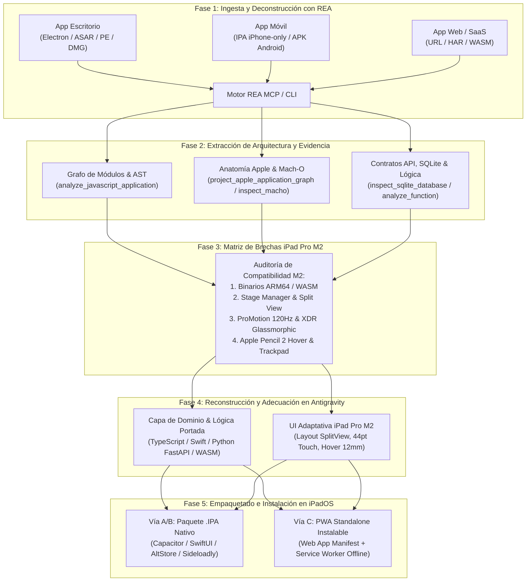

# 📱 Pipeline de Ingeniería Inversa con REA para Adecuar Aplicaciones al iPad Pro M2

> **Desarrollador Líder:** Rogerr Carvajal ([@rogerrcarvajal](https://github.com/rogerrcarvajal))  
> **Ubicación:** `Docs-Antigravity/04-Workflow-iPad-Pro-M2/01-Pipeline-Ingenieria-Inversa-iPad-Pro-M2.md`  
> **Dispositivo Objetivo:** iPad Pro M2 (Chip Apple M2 8-core CPU / 10-core GPU, 8GB/16GB RAM, iPadOS, Liquid Retina / XDR ProMotion 120Hz, Apple Pencil 2 Hover, Magic Keyboard)  
> **Habilidad Asociada:** [`.agents/skills/rea-ipad-pro-m2-porter/SKILL.md`](../../.agents/skills/rea-ipad-pro-m2-porter/SKILL.md)

---

## 📌 1. El Problema que Resuelve este Pipeline

Muchas aplicaciones de referencia con excelente arquitectura o funcionalidades clave presentan uno de estos **4 bloqueos** cuando intentas usarlas en tu **iPad Pro M2**:

1. **Aplicaciones Exclusivas de Escritorio (Electron / Windows `.exe` / macOS `.dmg`):** No existen en la App Store de iPadOS o dependen de APIs de Node.js/escritorio (`ipcMain`, `fs`, binarios `x86_64`).
2. **Aplicaciones iOS Diseñadas Solo para iPhone (`UIDeviceFamily = [1]`):** Se ejecutan en modo de compatibilidad reducido en el iPad Pro M2 (con bordes negros, sin aprovechar los 120Hz ni Stage Manager, y sin soporte para Magic Keyboard o Apple Pencil Hover).
3. **Aplicaciones Android (`.apk`) Sin Versión para iPadOS:** Tienen flujos y lógica valiosos pero están empaquetadas en Dalvik/DEX o Flutter Android.
4. **Aplicaciones Web / SaaS No Adecuadas para iPadOS:** Tienen interfaces pensadas solo para ratón de escritorio, fallan en eventos táctiles/gestos de Safari iPadOS, no se instalan a pantalla completa (`standalone`) y pierden estado al quedarse sin conexión.

---

## 🔄 2. Arquitectura del Pipeline de 5 Fases (REA → iPad Pro M2)



---

## 🔍 3. Recetas de Inspección con REA Según el Tipo de Aplicación

### Caso 1: Analizar una Aplicación Electron / JavaScript de Escritorio para Portarla al iPad Pro M2
1. **Inspeccionar el paquete ASAR o carpeta de la aplicación:**
   ```bash
   npx rea-agents analyze-javascript-application "C:/ruta/a/app.asar" --json > app-evidence.json
   ```
   O mediante herramienta MCP:
   ```json
   {
     "name": "analyze_javascript_application",
     "arguments": {
       "path": "C:/ruta/a/app.asar",
       "detail": "summary"
     }
   }
   ```
2. **Rastrear una funcionalidad específica desde la UI hasta el sistema (`trace_application_feature`):**
   Identifica qué módulos son puros (reutilizables directamente en iPadOS) y cuáles cruzan la frontera de Electron (`ipcRenderer` → `ipcMain` → addons `.node`).
3. **Sustituir fronteras de escritorio:**
   - Llamadas a `fs` / `sqlite3` nativo → migrar a **SQLite WASM / Origin Private File System (OPFS)** o plugin nativo de **Capacitor Filesystem/SQLite** en ARM64.
   - Ventanas fijas `BrowserWindow` → migrar a vistas adaptativas compatibles con **Stage Manager** en iPadOS.

### Caso 2: Analizar un `.ipa` (iPhone) o `.app` / `.dmg` (macOS) para Adecuarlo al iPad Pro M2
1. **Abrir el paquete e inventariar su estructura:**
   - `open_binary` con la ruta del `.ipa` o `.app`.
   - `inspect_artifact` (`detail: "summary"`) → `project_apple_application_graph`.
2. **Auditar `Info.plist` y ejecutables Mach-O:**
   - Ejecutar `inspect_plist` sobre `Payload/App.app/Info.plist`:
     - Comprobar `UIDeviceFamily`: si solo tiene `[1]`, está restringido a iPhone y se verá escalado en el iPad Pro M2.
     - Comprobar `UIRequiresFullScreen`: si es `true`, impide usar **Split View** y **Stage Manager**.
   - Ejecutar `inspect_macho` y `trace_dylib_resolution` con `"architecture": "arm64"`:
     - Verificar que el ejecutable principal y todos los `Frameworks/*.framework` tengan slice **`arm64`** válido y sin `@rpath` rotos.
   - Ejecutar `decode_interface_builder` e `inspect_asset_catalog`:
     - Extraer la jerarquía de vistas de los `.storyboardc` / `.nib` y los iconos/imágenes de `Assets.car` para rediseñarlos a resolución Retina `@2x` de iPad Pro.

### Caso 3: Analizar una APK de Android para Reconstruirla en iPad Pro M2
1. Ejecutar `inspect_android_package` y `inspect_apktool_resources` (o `inspect_flutter_artifact` si es Flutter).
2. Extraer el árbol de pantallas, modelos de datos, endpoints REST/GraphQL y bases de datos locales (`inspect_sqlite_database`).
3. Construir el **Ledger de Obligaciones (`build_reconstruction_obligation_ledger`)** y generar la versión para iPadOS con arquitectura limpia.

---

## 📐 4. Especificaciones de Hardware y UI del iPad Pro M2 (Tabla de Referencia para Agentes)

| Parámetro del iPad Pro M2 | Valor Técnico Exacto | Regla de Implementación Obligatoria |
| :--- | :--- | :--- |
| **SoC / Arquitectura** | Apple M2 (`arm64` / `arm64e`, 8 núcleos CPU, 10 núcleos GPU, Neural Engine 16 núcleos) | Cero código `x86_64`. Usar compilación nativa `arm64` para iPadOS o WebAssembly SIMD + WebGPU/WebGL2. |
| **Viewport 11 pulgadas** | `1194 × 834 pt` (`2388 × 1668 px` @ `2x`) | Breakpoints responsivos para Split View (1/3 = `320pt`, 1/2 = `580pt`, 2/3 = `810pt`, Full = `1194pt`). |
| **Viewport 12.9 pulgadas (XDR)** | `1366 × 1024 pt` (`2732 × 2048 px` @ `2x`) | Aprovechar paneles multi-columna (Sidebar + Lista + Detalle + Inspector) en modo horizontal. |
| **Tasa de Refresco (ProMotion)** | Adaptativa `24Hz – 120Hz` (`8.33 ms` por frame) | Animaciones basadas en transformaciones GPU (`transform`, `opacity`) sin bloquear el hilo principal por más de `8ms`. |
| **Apple Pencil 2 (Hover)** | Detección electromagnética hasta `12 mm` sobre el cristal | Soportar previsualización de herramientas en `pointermove` (cuando `pointerType === "pen"` y `buttons === 0`) o `UIHoverGestureRecognizer`. |
| **Magic Keyboard & Trackpad** | Puntero adaptativo de iPadOS + Atajos `Cmd + Tecla` | Registrar atajos de teclado globales y efectos de resaltado magnético en botones y tarjetas. |
