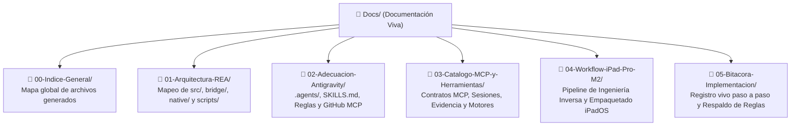

# 🚀 Documentación Viva: REA (Reverse Engineer Anything) en Google Antigravity + Portabilidad iPad Pro M2

> **Desarrollador Líder:** Rogerr Carvajal ([@rogerrcarvajal](https://github.com/rogerrcarvajal))  
> **Especialidad:** Arquitectura de Software con Modelos y Agentes Inteligentes  
> **Repositorio Sincronizado (GitHub MCP):** [`https://github.com/rogerrcarvajal/REA`](https://github.com/rogerrcarvajal/REA)  
> **Repositorio Base Upstream:** [`https://github.com/morluto/rea`](https://github.com/morluto/rea) (v6.5.0)  
> **Fecha de Inicialización:** 17 de Octubre de 2026  

[-000000?style=for-the-badge&logo=apple&logoColor=white)](./04-Workflow-iPad-Pro-M2/01-Pipeline-Ingenieria-Inversa-iPad-Pro-M2.md)

---

## 📌 1. Visión General del Proyecto

Este proyecto integra el motor **REA (Reverse Engineer Anything)** dentro del ecosistema de **Google Antigravity** bajo los estándares de arquitectura multi-agente de **Rogerr Carvajal**, con un doble propósito estratégico:

1. **Ingeniería Inversa Guiada por Evidencia:** Analizar cualquier aplicación, binario nativo (Mach-O, PE, ELF), paquete móvil (`.ipa`, `.apk`), aplicación de escritorio (Electron/ASAR/JavaScript), ensamblado `.NET`, base de datos SQLite o captura web para extraer su **arquitectura de software, contratos de interfaz y lógica de negocio** con evidencia verificable (`Evidence Ledger`).
2. **Adecuación y Portabilidad hacia iPad Pro M2:** Tomar aplicaciones que **aún no están diseñadas ni adecuadas para el iPad Pro M2** (aplicaciones exclusivas de escritorio, apps de iPhone sin soporte iPadOS, APKs de Android o SaaS web no instalables) y **reconstruirlas, rediseñarlas y empaquetarlas** para que puedan **instalarse como aplicaciones nativas (`.ipa`) o PWA Standalone y ejecutarse sin problemas** aprovechando el chip Apple M2 (`arm64`), pantallas Liquid Retina XDR a 120Hz (ProMotion), Stage Manager, Apple Pencil 2 Hover y Magic Keyboard.

---

## 🗺️ 2. Mapa de la Estructura de Documentación Viva (`Docs/`)

La carpeta `Docs/` está organizada en **6 subcarpetas temáticas** que reflejan exactamente la estructura de archivos generados del repositorio REA y de la configuración profunda de Antigravity:

### Índice Detallado de Documentos

| Subcarpeta | Documento Markdown | Contenido y Relación con los Archivos del Proyecto |
| :--- | :--- | :--- |
| **`00-Indice-General/`** | [`01-Mapa-de-Archivos-Generados.md`](./00-Indice-General/01-Mapa-de-Archivos-Generados.md) | Correlación completa entre el árbol de directorios del proyecto (`src/`, `bridge/`, `native/`, `.agents/`, `.gemini/`, `Docs/`) y cada módulo funcional. |
| **`01-Arquitectura-REA/`** | [`01-Arquitectura-Hexagonal-y-Dominios.md`](./01-Arquitectura-REA/01-Arquitectura-Hexagonal-y-Dominios.md) | Análisis arquitectónico de las capas `src/domain/`, `src/contracts/`, `src/application/`, `src/composition/`, `src/server/` y `src/cli/`. |
| **`01-Arquitectura-REA/`** | [`02-Puentes-Nativos-y-Proveedores.md`](./01-Arquitectura-REA/02-Puentes-Nativos-y-Proveedores.md) | Documentación de `bridge/` (Hopper Python, Ghidra Java, JADX, LLDB Swift/Python, mitmproxy, pwntools) y `native/windows/`. |
| **`02-Adecuacion-Antigravity/`** | [`01-Configuracion-Agents-y-Skills.md`](./02-Adecuacion-Antigravity/01-Configuracion-Agents-y-Skills.md) | Cómo se fusionó el ecosistema `.agents/` de REA con las 4 habilidades globales de Antigravity y la nueva skill `rea-ipad-pro-m2-porter`. |
| **`02-Adecuacion-Antigravity/`** | [`02-Sincronizacion-GitHub-MCP.md`](./02-Adecuacion-Antigravity/02-Sincronizacion-GitHub-MCP.md) | Configuración de `mcp_config.json` (servidores `github` y `rea`), estrategia de remotos `origin` (`rogerrcarvajal/REA`) y `upstream` (`morluto/rea`). |
| **`03-Catalogo-MCP-y-Herramientas/`** | [`01-Contratos-MCP-y-Flujo-Evidencia.md`](./03-Catalogo-MCP-y-Herramientas/01-Contratos-MCP-y-Flujo-Evidencia.md) | Guía de referencia de las herramientas MCP de REA, manejo de `Evidence`, `inspect_analysis_view`, `record_unknown` y perfiles de esquema (`compact`). |
| **`04-Workflow-iPad-Pro-M2/`** | [`01-Pipeline-Ingenieria-Inversa-iPad-Pro-M2.md`](./04-Workflow-iPad-Pro-M2/01-Pipeline-Ingenieria-Inversa-iPad-Pro-M2.md) | Metodología de 5 fases para analizar apps de escritorio/móviles/web con REA y auditar brechas para el iPad Pro M2. |
| **`04-Workflow-iPad-Pro-M2/`** | [`02-Guia-Empaquetado-IPA-PWA-Catalyst.md`](./04-Workflow-iPad-Pro-M2/02-Guia-Empaquetado-IPA-PWA-Catalyst.md) | Guía técnica para empaquetar e instalar aplicaciones en el iPad Pro M2 vía `.ipa` (Capacitor/SwiftUI/AltStore/Sideloadly) o PWA Standalone iPadOS. |
| **`05-Bitacora-Implementacion/`** | [`01-Walkthrough-Adecuacion-Viva.md`](./05-Bitacora-Implementacion/01-Walkthrough-Adecuacion-Viva.md) | Bitácora cronológica de todos los comandos, decisiones de diseño, respaldos de reglas y validaciones ejecutadas. |

---

## 🎛️ 3. Aplicaciones Desarrolladas con REA para iPad Pro M2 (Mackie MainStream & Mackie Matrix)

| Aplicación | Carpeta de Desarrollo | Documentación Viva | Propósito en iPad Pro M2 (iPadOS 17+ / Apple Silicon ARM64) |
| :--- | :--- | :--- | :--- |
| **Mackie MainStream Studio M2** | [`../Mackie-MainStream-App/`](../Mackie-MainStream-App/index.html) | [`../Mackie-MainStream-App/Docs/README.md`](../Mackie-MainStream-App/Docs/README.md) | Soluciona los fallos de entrada de video HDMI UVC al conectar el Mackie MainStream al iPad Pro M2 mediante perfiles UVC con cascada de fallback (`1080p30 Safe Hub`, `1080p60`, `720p60`), bloqueo de reloj UAC2 a `48 kHz / 24-bit`, compensador A/V Sync (`0–300 ms`), Watchdog Anti-Drop y Scopes Broadcast a 120Hz (Waveform, Histograma RGB, VU/LUFS). |
| **Mackie Matrix Console M2** | [`../Mackie-Matrix-App/`](../Mackie-Matrix-App/index.html) | [`../Mackie-Matrix-App/Docs/README.md`](../Mackie-Matrix-App/Docs/README.md) | Reconstrucción funcional completa de `Mackie Matrix.exe` (`ev_78d3359d81c24faf54d45ebacfb1498f0616e46ac2e3615bff7ffedbe85918fd`) para iPad Pro M2: matriz de enrutamiento de 9 canales de entrada × 4 Submixes de salida, importador/exportador nativo de archivos `.mackie` (`[V1]` y `[V2]`), EQ Paramétrico interactivo de 5 bandas, cadena vocal MVoice/VFX y Sampler de 32 Pads (Bancos A, B, C, D). |
