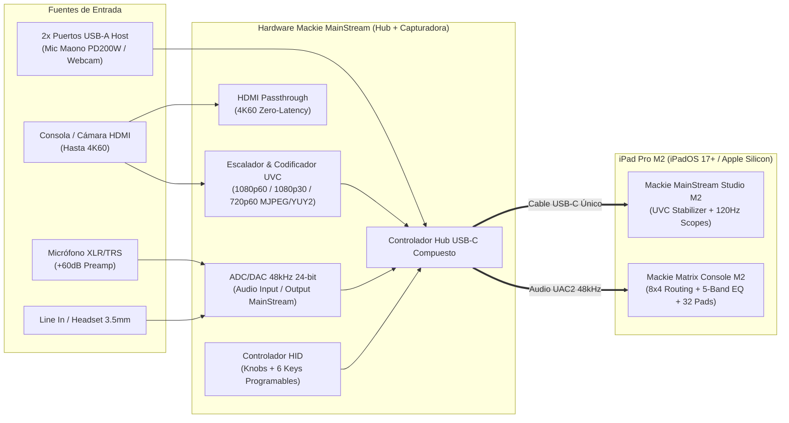

# 🔬 01. Ingeniería Inversa con REA: Hardware Mackie MainStream

**Autor:** Rogerr Carvajal ([@rogerrcarvajal](https://github.com/rogerrcarvajal))  
**Insumos Analizados:** `D:\Installers\Mackie Mainstream\` y `C:\Program Files\Mackie Matrix\`

---

## 1. Taxonomía de Evidencia REA (Observado vs. Derivado vs. Inferido)

Siguiendo las reglas de gobernanza de **REA (Reverse Engineer Anything)**, se documentan los hallazgos separando estrictamente hechos observados de derivaciones e inferencias:

### A. Hechos Observados (`Observed`)
1. **Insumos Locales en `D:\Installers\Mackie Mainstream`**:
   - Manual oficial en español: `Manual de usuario Mackie MainStream (Español - 64 páginas).pdf` (`311,648 bytes`).
   - Manuales en inglés: `MAINSTREAM_OM.pdf` (`1,391,829 bytes`), `MAINSTREAM_QSG.pdf` (`1,222,742 bytes`), `MACKIE MATRIX OM.pdf` (`628,468 bytes`).
   - Configuraciones reales del usuario:
     - `Mackie Mainstream - Backup.mackie` (Esquema `[V1]`, `16,580 bytes`).
     - `MainStream Config\MainStream - Config Backup.mackie` (Esquema `[V2]`, `104,012 bytes`, `1,254 líneas`).
2. **Endpoints de Hardware Registrados en la Configuración del Usuario**:
   - En `MainStream - Config Backup.mackie` (líneas 29, 44, 62, 778, 910):
     - Entrada de audio principal del dispositivo: `Audio Input (2- MainStream)` / `Audio Input (MainStream)`.
     - Salida de monitoreo hardware del dispositivo: `Audio Output (2- MainStream)`.
     - Micrófono USB auxiliar en el hub/sistema: `Microphone (Maono PD200W Mic USB)` / `Microphone (Maono AI Microphone)`.
3. **Arquitectura Física del Dispositivo Mackie MainStream**:
   - **Sección de Video HDMI**:
     - Entrada HDMI 1.4/2.0 hasta **4K @ 60fps** (fuente: consolas, cámaras DSLR, PC secundario).
     - Salida HDMI Passthrough de latencia cero hasta **4K @ 60fps** para monitor externo.
     - Captura de video USB-C (UVC — *USB Video Class*) hasta **1080p @ 60fps** hacia el host principal (PC o iPad Pro M2).
   - **Sección de Audio UAC2 (USB Audio Class) y Analógica**:
     - Preamplificador combo XLR/TRS para micrófono profesional con hasta **+60 dB** de ganancia limpia.
     - Entrada de headset de 3.5 mm (TRRS), entrada auxiliar estéreo de 3.5 mm (Smartphone/Line In), salida de auriculares de 3.5 mm y salidas de monitores L/R TRS de 1/4".
     - Conversión digital a **48 kHz / 24-bit**.
   - **Hub USB-C Integrado**:
     - Incluye 2 puertos USB-A de expansión para conectar cámaras web USB, micrófonos USB adicionales (como el Maono PD200W observado en el backup del usuario) o periféricos.
   - **Superficie de Control Superior**:
     - 4 potenciómetros rotativos principales (Main Out, Phones, Mic Gain, Chat/HDMI Balance) y **6 teclas programables (`Keys 1–6`)**.

---

## 2. Diagrama de Topología de Buses del Mackie MainStream

