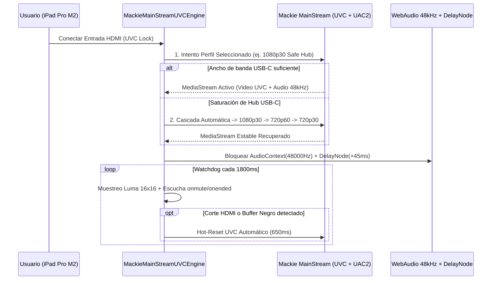

# ⚡ 02. Diagnóstico y Solución al Fallo de Video de Entrada en iPad Pro M2

**Autor:** Rogerr Carvajal ([@rogerrcarvajal](https://github.com/rogerrcarvajal))  
**Dispositivo:** Mackie MainStream conectado vía USB-C a iPad Pro M2 (iPadOS 17+)

---

## 1. ¿Por qué falla el video de entrada del Mackie MainStream en el iPad Pro M2?

Al conectar el **Mackie MainStream** directamente al puerto Thunderbolt / USB 4 del **iPad Pro M2**, el dispositivo se anuncia como un **Dispositivo Compuesto USB (*Composite USB Device*)** que agrupa simultáneamente:
1. Un Hub USB 2.0/3.0 interno (con 2 puertos USB-A adicionales).
2. Un endpoint de video isócrono **UVC (USB Video Class)** capaz de enviar hasta 1080p60.
3. Un endpoint de audio bidireccional **UAC2 (USB Audio Class 2.0)** a **48 kHz / 24-bit**.
4. Una interfaz **HID** para las teclas y controles del panel frontal.

### Las 3 Causas Técnicas del Fallo en iPadOS 17+:
1. **Colisión de Ancho de Banda Isócrono (`OverconstrainedError` / `AbortError`)**:
   - Cuando una aplicación genérica de iPadOS invoca `getUserMedia({ video: true })` sin restricciones explícitas, WebKit/AVCaptureSession intenta negociar el primer descriptor de formato sin comprimir (`YUY2` o `NV12` a 1080p60) o el modo de mayor tasa de bits. Al compartir el bus con el Hub USB interno y el flujo UAC2 de 48 kHz, el controlador USB de iPadOS descarta paquetes isócronos y la imagen queda en **pantalla negra o se congela tras pocos segundos**.
2. **Desajuste de Reloj de Muestreo Audio/Video (44.1 kHz vs 48.0 kHz)**:
   - El ADC interno del Mackie MainStream opera nativamente a **48,000 Hz**. Si `AVAudioSession` en iPadOS arranca en `44,100 Hz` con filtros de voz activos (`echoCancellation: true`), se producen micro-cortes (*glitches*) que reinician el pipeline multimedia compartido con el video UVC.
3. **Suspensión de Endpoint tras Cambio de Resolución HDMI (`onmute` / `onended`)**:
   - Cuando la consola o cámara conectada al HDMI cambia de resolución (ej. de menú 1080p a juego 4K60 passthrough), el escalador del MainStream silencia brevemente el endpoint UVC (`MediaStreamTrack.onmute`). Las apps convencionales de iPad no re-negocian el stream y dejan el visor congelado permanentemente.

---

## 2. Arquitectura de la Solución Implementada (`js/uvc-engine.js`)

En [`uvc-engine.js`](../js/uvc-engine.js) se diseñó la clase `MackieMainStreamUVCEngine` con **4 mecanismos de protección específicos para iPad Pro M2**:

### Detalles Clave del Código:
- **Perfiles UVC Deterministas (`UVC_PROFILES`)**:
  - `1080p30-safe` (*Recomendado en iPad Pro M2*): Fija `width: 1920, height: 1080, frameRate: 30, resizeMode: 'none'`, reduciendo a la mitad la presión isócrona sobre el bus USB-C sin perder nitidez Full HD 1080p.
  - `1080p60-pro`: Para uso con hub Thunderbolt alimentado externamente (USB-PD).
  - `720p60-gaming`: Prioriza 60 fps reales con bajo ancho de banda USB.
- **Bloqueo de Reloj UAC2 48 kHz Puro**:
  - Desactiva `echoCancellation`, `noiseSuppression` y `autoGainControl` para preservar el rango dinámico limpio de +60 dB del preamplificador Mackie y fija `sampleRate: 48000`.
- **Compensador A/V Sync (`0–300 ms`)**:
  - Inserta un `DelayNode` de alta precisión (`45 ms` por defecto) para alinear exactamente el audio analógico/XLR con la latencia de codificación UVC del video HDMI.
