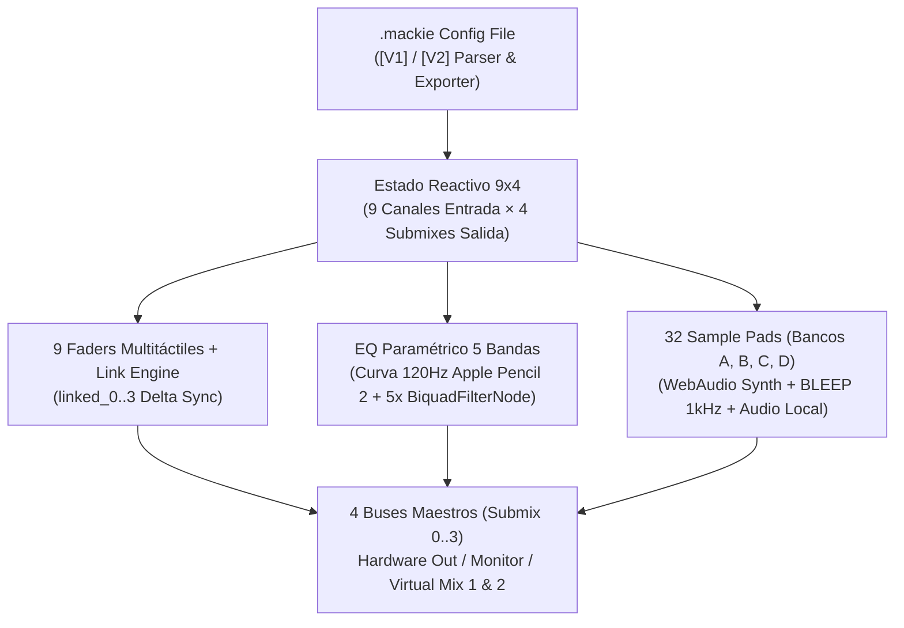

# 🎛️ 03. Arquitectura DSP y Manual de Instalación en iPad Pro M2

**Autor:** Rogerr Carvajal ([@rogerrcarvajal](https://github.com/rogerrcarvajal))

---

## 1. Arquitectura de la Consola Digital en iPadOS 17+ (`Mackie-Matrix-App`)



### Características Clave Reconstruidas para el iPad Pro M2:
1. **Pre-carga Automática de tu Backup Real**:
   - Al abrir la aplicación, carga automáticamente tu archivo real `MainStream - Config Backup.mackie` (`[V2]`), incluyendo tus canales personalizados (`Main Stream`, `Maono PD 200W`, `Audio Auxiliar`, `Game`, `Chat`, `Music`, `Browser`, `System`, `Samples`), tus presets de ecualización (`Eq Main Stream`, `Eq Mix Atream 1`, `Eq Monitoring`, `Eq Submix Output - VM2`) y tus 32 pads de sonido (incluyendo los efectos del Banco A y tus audios personalizados de OBS en el Banco B).
2. **Enlace Inteligente de Faders (`linked_0..3`)**:
   - Si el botón `🔗` está activo en un canal, mover su fader en el Submix 1 ajusta proporcionalmente los demás submixes enlazados respetando el diferencial (`delta`), idéntico al comportamiento en C++/Qt6 de `Mackie Matrix.exe`.
3. **Importación y Exportación `.mackie` Bidireccional**:
   - Puedes importar cualquier archivo `.mackie` desde la app **Archivos (*Files*)** del iPad Pro M2 y exportar tus nuevos ajustes desde el iPad para volverlos a cargar en tu PC con Windows.

---

## 2. Cómo Instalar `Mackie Matrix M2` en el iPad Pro M2

1. Abre en Safari de tu iPad Pro M2 la ruta:
   - `http://localhost/REA/Mackie-Matrix-App/` (o `http://<IP-DE-TU-PC>/REA/Mackie-Matrix-App/`).
2. Toca **Compartir** -> **"Añadir a la pantalla de inicio"**.
3. Para compilar como paquete nativo `.ipa` mediante Xcode y Capacitor:
   ```bash
   cd Mackie-Matrix-App
   npm init -y
   npm install @capacitor/core @capacitor/cli @capacitor/ios
   npx cap add ios
   npx cap sync ios
   npx cap open ios
   ```
