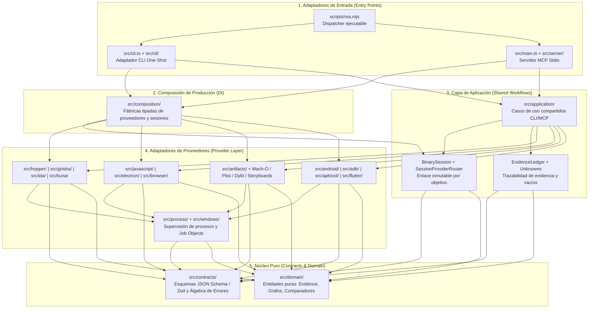

# 🏗️ Arquitectura Hexagonal y Dominios del Motor REA (`src/`)

> **Desarrollador Líder:** Rogerr Carvajal ([@rogerrcarvajal](https://github.com/rogerrcarvajal))  
> **Ubicación:** `Docs/01-Arquitectura-REA/01-Arquitectura-Hexagonal-y-Dominios.md`  
> **Referencia de Código:** [`AGENTS.md`](../../AGENTS.md), [`docs/architecture.mermaid`](../../docs/architecture.mermaid)

---

## 1. Flujo de Dependencias Hacia el Interior (Inward Dependency Rule)

REA implementa una **Arquitectura Limpia y Hexagonal (Ports & Adapters)** estricta verificada por `npm run verify:architecture-guards` y `npm run verify:module-boundaries`. Las dependencias fluyen exclusivamente hacia adentro:

---

## 2. Reglas Arquitectónicas Clave de REA para Referencia de Desarrollo

Al usar REA como referencia arquitectónica para otros proyectos de software, destacan cinco patrones de ingeniería de alto nivel:

### A. Propiedad Única de Recursos y Ciclo de Vida (`Own the Lifecycle`)
- Todo recurso externo (proceso hijo, base de datos temporal de Ghidra, socket Unix/Windows, directorio de extracción) tiene un **único propietario (`owner`)** en `src/process/` y `src/providers/`.
- Un simple `PID` y ruta de ejecutable **no bastan** para probar que un proceso sigue perteneciendo a REA tras su salida o reutilización de PID por el sistema operativo; REA utiliza tokens de ejecución verificados (`ProcessRunTokenReader`) y **Job Objects en Windows (`native/windows/`)**.
- Si la limpieza falla al cerrar una sesión (`close_binary`), REA **conserva la propiedad del recurso** y reporta `cleanup_incomplete` para reintento determinista.

### B. Normalización en la Frontera Productora (`Parse, Don't Validate Downstream`)
- Cada formato (Mach-O, PE, ELF, ASAR, APK, Plist, SQLite, HAR) se parsea y normaliza **una sola vez** en el adaptador productor.
- Los consumidores posteriores (`compare_functions`, `project_apple_application_graph`, `trace_application_feature`) operan únicamente sobre **hechos tipados y validados**, nunca reinterpretando cadenas crudas.

### C. Álgebra de Errores Etiquetada y `Result`
- Los fallos esperados de frontera (archivo corrupto, proveedor no disponible, timeout de arranque, límite de transporte MCP de 10 MiB) se modelan con tipos discriminados (`errorSchemas.ts`) en lugar de excepciones no controladas.
- Cuando un resultado supera el presupuesto de transporte stdio (10 MiB), REA **no trunca silenciosamente el JSON**: retiene el registro completo en la sesión (`EvidenceLedger`) y devuelve un error estructurado `resource_constraint` con la referencia exacta (`evidence_reference`) y una continuación lista para paginar mediante `inspect_analysis_view`.

### D. Presupuesto de Contexto para Agentes (`Agent Token Efficiency`)
- REA optimiza sus respuestas en este orden estricto:
  1. **Tokens y ventana de contexto del agente:** Modo `detail: "summary"`, paginación por unidades UTF-16 o filas, y referencias retenidas (`{"kind": "retained-evidence", "evidence_id": "ev_..."}`).
  2. **Tiempo de análisis:** Caché de instantáneas (`AnalysisSnapshotCache`) invalidada por hash criptográfico SHA-256 del objetivo y perfil de análisis.
  3. **CPU y Memoria:** Workers acotados con límites de heap para Source Maps, AST de JavaScript y SQLite.
