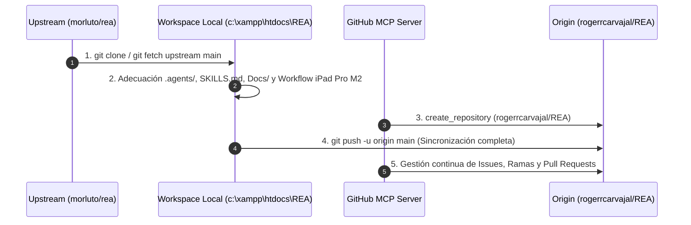

# 🔌 Conexión MCP (REA + GitHub) y Sincronización del Repositorio

> **Desarrollador Líder:** Rogerr Carvajal ([@rogerrcarvajal](https://github.com/rogerrcarvajal))  
> **Ubicación:** `Docs/02-Adecuacion-Antigravity/02-Sincronizacion-GitHub-MCP.md`  
> **Repositorio Propio (`origin`):** [`https://github.com/rogerrcarvajal/REA.git`](https://github.com/rogerrcarvajal/REA)  
> **Repositorio Original (`upstream`):** [`https://github.com/morluto/rea.git`](https://github.com/morluto/rea)

---

## 1. Configuración Unificada de Servidores MCP (`mcp_config.json`)

Tanto en el nivel de workspace ([`.agents/mcp_config.json`](../../.agents/mcp_config.json) y [`.gemini/mcp_config.json`](../../.gemini/mcp_config.json)) como en el nivel global de Antigravity (`~/.gemini/config/mcp_config.json`), se han registrado simultáneamente el servidor **GitHub MCP** y el servidor **REA MCP**:

```json
{
  "mcpServers": {
    "github": {
      "command": "npx",
      "args": [
        "-y",
        "@modelcontextprotocol/server-github"
      ],
      "env": {
        "GITHUB_PERSONAL_ACCESS_TOKEN": "${GITHUB_PERSONAL_ACCESS_TOKEN}"
      }
    },
    "rea": {
      "command": "cmd.exe",
      "args": [
        "/d",
        "/c",
        "npx",
        "-y",
        "rea-agents@6.5.0",
        "mcp"
      ],
      "env": {
        "REA_MCP_INPUT_SCHEMA_PROFILE": "compact",
        "REA_MCP_MAX_RESPONSE_BYTES": "10485760"
      }
    }
  }
}
```

### Decisiones Técnicas de la Configuración MCP en Windows:
1. **Wrapper `cmd.exe /d /c npx -y rea-agents@6.5.0 mcp`:** Siguiendo las especificaciones oficiales de [`docs/installation.md`](../../docs/installation.md), en Windows nativo los clientes stdio deben invocar `npx` a través de `cmd.exe /d /c` para resolver correctamente el shim `.cmd` de npm sin errores de spawn.
2. **Perfil de Esquema Compacto (`REA_MCP_INPUT_SCHEMA_PROFILE = "compact"`):** Reduce el tamaño de los más de 170 esquemas JSON de entrada a menos de 13 KB por herramienta (~68k tokens frente a ~120k tokens en modo `full`), evitando saturar la ventana de contexto del agente mientras mantiene el 100% de las herramientas y la validación canónica en el servidor.
3. **Presupuesto de Respuesta (`REA_MCP_MAX_RESPONSE_BYTES = "10485760"`):** Fija el límite seguro de 10 MiB por trama JSON-RPC stdio, activando la paginación inteligente con `inspect_analysis_view` cuando un binario o aplicación supera ese tamaño.

---

## 2. Arquitectura de Sincronización Dual en Git (`origin` + `upstream`)

Para mantener todas las mejoras de adecuación a Antigravity, la documentación viva en `Docs/` y los flujos para **iPad Pro M2** en tu cuenta de GitHub sin perder la capacidad de recibir actualizaciones del motor oficial REA (`morluto/rea`), se configuró una topología de doble remoto:



### Comandos de Sincronización Periódica

1. **Subir tus cambios, nuevas documentaciones de `Docs/` o análisis de apps a tu repositorio (`origin`):**
   ```powershell
   git add .
   git commit --no-gpg-sign -m "docs(rea): actualización de análisis y documentación viva"
   git push origin main
   ```

2. **Traer nuevas versiones del motor REA oficial (`upstream`) conservando tu configuración Antigravity y `Docs/`:**
   ```powershell
   git fetch upstream
   git merge upstream/main --no-gpg-sign -m "chore(upstream): sincronizar última versión de morluto/rea"
   git push origin main
   ```
